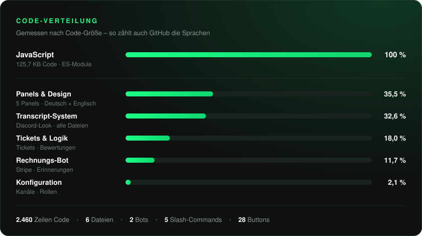
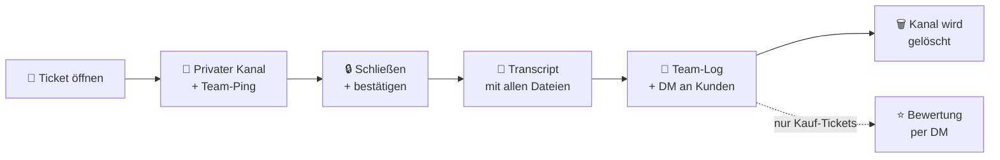
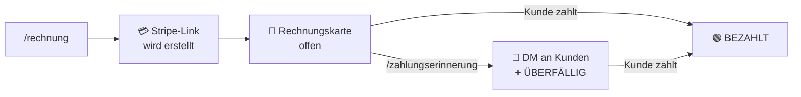
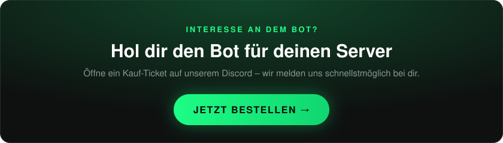

<h1>Gevo Studio · Discord Bot</h1>

<b>Der All-in-One-Bot für deinen Discord-Server</b> 
Tickets, Transcripts, Bewertungen, Rechnungen und mehr – live im Einsatz bei <a href="https://gevo-studio.de">Gevo Web Studio</a>.

<a href="#-code--sprachen">Code</a> ·
<a href="#-funktionen">Funktionen</a> ·
<a href="#-commands">Commands</a> ·
<a href="#-buttons--automatik">Buttons</a> ·
<a href="#-panels">Panels</a> ·
<a href="#-sicherheit">Sicherheit</a> ·
<a href="#-jetzt-bestellen"><b>Jetzt bestellen</b></a>

 

## 📊 Code & Sprachen

 

## ✨ Funktionen

### 🛡️ Server & Support

<table>
<tr><th align="left" width="190">Funktion</th><th align="left">Was sie macht</th></tr>
<tr><td>🎫 <b>Ticket-System</b></td><td>4 Ticket-Arten: <b>Support</b>, <b>Kauf</b>, <b>Partner</b> und <b>Geschäftsführung</b>. Jedes Ticket bekommt einen eigenen privaten Kanal in seiner Kategorie, eine fortlaufende Nummer (z. B. <code>kauf-12</code>) und eine Willkommenskarte mit dem Avatar des Kunden. Das Team wird automatisch angepingt, und pro Person ist je Art nur ein offenes Ticket möglich.</td></tr>
<tr><td>📜 <b>Transcripts</b></td><td>Beim Schließen speichert der Bot den kompletten Verlauf als Webseite im Discord-Look: Nachrichten, Bilder, Videos, Dateien, Avatare, Emojis, Sticker und Embeds. Der Link und eine HTML-Sicherung gehen in den Team-Log und per DM an den Kunden. Der Kanal wird erst gelöscht, wenn alles sicher gespeichert ist.</td></tr>
<tr><td>⭐ <b>Bewertungen</b></td><td>Nach einem Kauf-Ticket bekommt der Kunde per DM 1 bis 5 Sterne zur Auswahl und danach ein kurzes Feedback-Formular. Die Bewertung erscheint mit Avatar im Feedback-Kanal – pro Ticket nur einmal und nur vom Ticket-Inhaber.</td></tr>
<tr><td>✅ <b>Verifizierung</b></td><td>Hausregeln mit Button: Ein Klick vergibt die Member-Rolle und schaltet den Server frei.</td></tr>
<tr><td>📑 <b>Rechtliches</b></td><td>Impressum, Datenschutz, AGB und Widerruf als private Antwort mit Link zur Website.</td></tr>
<tr><td>⌛ <b>Lieferzeit</b></td><td>Live-Panel mit 4 Stufen (3–5 bis ab 21 Werktage), offenen Bestellungen, Fast-Delivery-Slots, bevorzugter Bearbeitung (+80 %) und Next Day Delivery (+120 %).</td></tr>
<tr><td>💎 <b>Preisliste</b></td><td>Einzelleistungen und Spar-Bundles mit privaten Detail-Preisen und Direktlink zum Kaufticket.</td></tr>
<tr><td>👋 <b>Willkommen</b></td><td>Begrüßungskarte mit Banner und Avatar für jedes neue Mitglied.</td></tr>
<tr><td>🌍 <b>Zweisprachig</b></td><td>Jedes Panel hat einen <i>translate</i>-Button, der die englische Version nur für dich anzeigt.</td></tr>
<tr><td>🔄 <b>Panel-Sync</b></td><td>Beim Start vergleicht der Bot alle Panels im Server mit dem Code und aktualisiert nur die, die sich geändert haben.</td></tr>
</table>

### 💳 Zahlungen & Rechnungen

<table>
<tr><th align="left" width="190">Funktion</th><th align="left">Was sie macht</th></tr>
<tr><td>🧾 <b>Rechnungen</b></td><td>Erstellt eine Rechnung mit sicherem Stripe-Bezahllink und postet eine Rechnungskarte mit Bezahl-Button.</td></tr>
<tr><td>🟢 <b>Bezahlt-Erkennung</b></td><td>Prüft alle 45 Sekunden die Bestellungen. Bezahlte Rechnungen springen automatisch von Rot auf Grün („BEZAHLT“), Beleg und Rechnung gehen per E-Mail raus.</td></tr>
<tr><td>🔔 <b>Zahlungserinnerung</b></td><td>Schickt dem Kunden eine DM mit Bezahllink und setzt die Karte auf „ÜBERFÄLLIG“.</td></tr>
<tr><td>💳 <b>Zahlungsmethoden</b></td><td>Zeigt alle Methoden: Apple Pay, Link, Amazon Pay, Visa, Mastercard, American Express, Klarna und mehr.</td></tr>
</table>

### So läuft ein Ticket ab

### So läuft eine Rechnung ab

 

## 💬 Commands

<table>
<tr><th align="left">Command</th><th align="left">Optionen</th><th align="left">Wer</th><th align="left">Was passiert</th></tr>
<tr><td><code>/panel</code></td><td><code>typ</code>: Ticket-System, Verifizieren, Rechtliches, Lieferzeit oder Preisliste</td><td>Admin</td><td>Postet das Panel im aktuellen Kanal neu</td></tr>
<tr><td><code>/lieferzeit</code></td><td><code>stufe</code> · <code>offene</code> · <code>fast_slots</code> · <code>bevorzugt</code> · <code>next_day</code> alle optional</td><td>Admin</td><td>Aktualisiert das Lieferzeit-Panel sofort</td></tr>
<tr><td><code>/rechnung</code></td><td><code>produkt</code> · <code>preis</code> optional: <code>kunde</code> · <code>beschreibung</code></td><td>Admin</td><td>Erstellt eine Rechnung mit Stripe-Bezahllink</td></tr>
<tr><td><code>/zahlungserinnerung</code></td><td><code>rechnung</code> optional: <code>kunde</code></td><td>Admin</td><td>Erinnert den Kunden per DM, Status „Überfällig“</td></tr>
<tr><td><code>/zahlungen</code></td><td>–</td><td>Alle</td><td>Zeigt alle Zahlungsmethoden</td></tr>
</table>

 

## ⚡ Buttons & Automatik

<table>
<tr><th align="left" width="260">Auslöser</th><th align="left">Was passiert</th></tr>
<tr><td>🎫 <b>Ticket öffnen</b> (4 Buttons)</td><td>Neuer privater Ticket-Kanal mit Willkommenskarte</td></tr>
<tr><td>🔒 <b>Ticket schließen</b></td><td>Abfrage „Ja, schließen“ oder „Abbrechen“, danach Transcript</td></tr>
<tr><td>✅ <b>Verifizieren</b></td><td>Vergibt die Member-Rolle</td></tr>
<tr><td>📑 <b>Rechtliches</b> (4 Buttons)</td><td>Zeigt Impressum, Datenschutz, AGB oder Widerruf privat an</td></tr>
<tr><td>💎 <b>Details ansehen</b> (5 Buttons)</td><td>Private Preisliste mit Button „Kaufticket eröffnen“</td></tr>
<tr><td>🌍 <b>translate</b> (6 Stellen)</td><td>Englische Version des Panels, nur für dich sichtbar</td></tr>
<tr><td>⭐ <b>1 bis 5 Sterne</b></td><td>Öffnet das Feedback-Formular (3 bis 500 Zeichen)</td></tr>
<tr><td>👋 <b>Neues Mitglied</b></td><td>Willkommenskarte mit Banner und Avatar</td></tr>
<tr><td>🚀 <b>Bot startet</b></td><td>Registriert die Commands und gleicht alle Panels ab</td></tr>
<tr><td>📜 <b>Ticket geschlossen</b></td><td>Transcript → Team-Log + DM → Bewertungsanfrage (Kauf) → Kanal nach 5 Sekunden gelöscht</td></tr>
<tr><td>⏱️ <b>Alle 45 Sekunden</b></td><td>Prüft, ob offene Rechnungen bezahlt wurden</td></tr>
</table>

 

## 🎨 Panels

 

## 🔒 Sicherheit

<ul>
<li>Admin-Commands sind nur für Administratoren sichtbar.</li>
<li>Ticket-Kanäle sind privat: Nur Kunde, Team und Bot haben Zugriff.</li>
<li>Transcripts sind geschützt: Alle Inhalte werden maskiert, kein JavaScript, strikte CSP und ein privater Zufalls-Link (128 Bit).</li>
<li>Rechnungen laufen nur über eine gesicherte Schnittstelle mit geheimem Schlüssel.</li>
<li>Kein Datenverlust: Ein Ticket wird erst gelöscht, wenn sein Transcript sicher gespeichert ist. Doppelklicks werden abgefangen.</li>
<li>Zugangsdaten liegen getrennt vom Code.</li>
</ul>

 

## 🛒 Jetzt bestellen

 

<b>Gevo Web Studio</b> · <a href="https://gevo-studio.de">gevo-studio.de</a> · <a href="https://discord.gg/j2P2CjaY8z">Discord</a> 
© 2026 Gevo Web Studio · Alle Rechte vorbehalten

